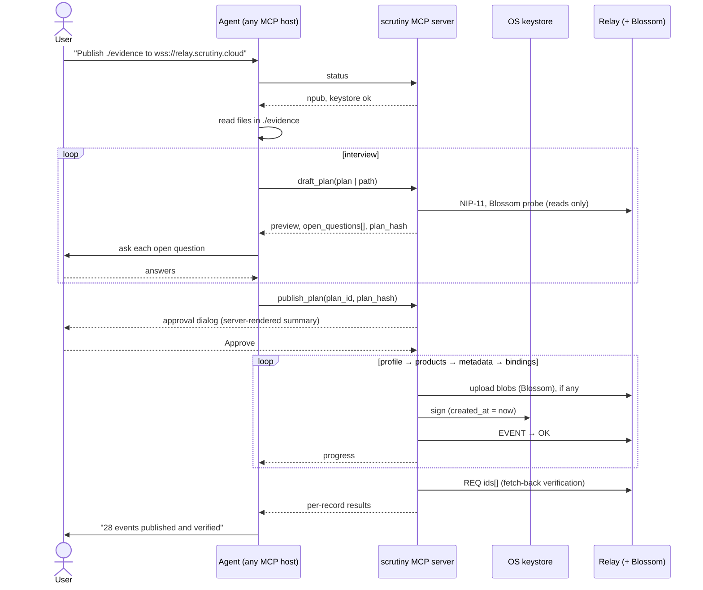

# Spec: plan-based publishing through MCP

| | |
|---|---|
| **Status** | Draft |
| **Date** | 2026-11-16 (rev. 5: chat fallback after a cancelled or unanswered approval dialog, §7; rev. 4: package `@crocs-muni/scrutiny-fabric-mcp`, §13; host snippets in the package README) |
| **Components** | `packages/mcp` (new, rewritten), `relay/` (Blossom endpoint) |
| **Decisions** | [ADR-0003](../adr/0003-mcp-plan-based-publishing.md) |
| **Supersedes** | Design in #108; prototype PRs #116–#121 |
| **Evidence** | [`investigations/publishing-system/REPORT.md`](../../investigations/publishing-system/REPORT.md), [`investigations/mcp-prototype/REPORT.md`](../../investigations/mcp-prototype/REPORT.md) |

Keywords **MUST**, **SHOULD**, **MAY** are used as in RFC 2119.

---

## 1. Purpose

A publisher has security-relevant files on their laptop: specifications, test reports, advisories,
SBOMs. They open any MCP-capable agent (Claude Code, Codex, …), add this server, and say *"publish
the data in this folder to SCRUTINY Fabric"*. The agent reads the folder, interviews the user,
drafts a **publication plan**, and shows it. The user approves it, in a dialog rendered by the
server where the host supports one. The server then signs every event with the user's key, held in
the OS keystore, and publishes them to the relays the user chose.

### 1.1 Happy path



### 1.2 Goals

- G1. Any MCP host can publish. No host-specific code paths are required for the happy path.
- G2. No publishable event is signed before the user has approved the plan. On the elicitation
  channel, the user approves the server's own rendering of the plan. On the chat fallback (§7), the
  agent relays that rendering, and G2 rests on the agent being honest, which is accepted under the
  Level 1 threat model (§3). Protocol-level auth events, namely NIP-42 `AUTH` (kind 22242) and
  Blossom upload authorisation (kind 24242), are not publishable events. They are never stored as
  fabric records.
- G3. The agent supplies **meaning**; the server derives everything **mechanical**: hashes, tags,
  composition, ids, timestamps.
- G4. A publish that is interrupted, times out or is partially rejected can be resumed without
  creating duplicate or forked events.
- G5. The signing key never appears in a tool argument, a tool result, the agent's context, a
  config file or the repository.

### 1.3 Non-goals (v1)

- Patches and retractions of events that are already published (§15).
- Deduplication across runs: running the same folder twice publishes twice (§15).
- Defending against a prompt-injected agent that has shell access (§3).
- Remote (HTTP) deployment, multi-tenant signing, NIP-46 bunkers, hardware signers.
- Linux machines without a Secret Service (headless, WSL) (§15).
- A full CLI for plans. The CLI covers key management only (§11).

---

## 2. Terms

| Term | Meaning |
|---|---|
| **Plan** | The JSON document the agent drafts: relays, records and artifacts, linked by local refs. It contains no ids, no `created_at` and no signatures |
| **Record** | One entry in a plan: `profile`, `product` or `metadata` |
| **Ref** | A local identifier for a record, `<type>:<slug>`, e.g. `product:ex-100`. Unique within a plan |
| **Template graph** | The plan after composition: every event's kind, content and tags are fixed, and the `e` tags still hold refs instead of ids |
| **Plan hash** | SHA-256 over the canonical template graph (§5.4). It is the thing the user approves |
| **Primary relay** | The first relay in `relays`. It gates progress and hosts Blossom blobs |
| **Mirror** | Any other relay in `relays`. It receives the same signed bytes after the run, best effort |
| **Journal** | A local file recording, for one run, each ref's signed event and its ack |
| **Open question** | Something the server found that needs a decision from the user before publishing |
| **Refusal** | The single error record shape (§10) |

---

## 3. Threat model

**v1 defends against an honest agent that makes mistakes (Level 1), and nothing stronger.**

| Threat | v1 defence |
|---|---|
| Agent publishes before the user has seen the plan | Approval bound to the plan hash (§7) |
| Agent misstates the plan to the user | On the elicitation channel the dialog is composed by the server. The chat fallback cannot prevent this (G2) |
| Agent invents facts | Each record names its `sources`; the preview shows them; rule 2a is enforced by the server |
| Agent computes a wrong hash, tag or id | The agent never computes these (G3) |
| Key leaks into a transcript, config or git | No tool accepts or returns key material; the key enters only through a TTY prompt in the CLI (§11) |
| Relay rejects part of a plan | Fixed ordering plus the journal (§8) |
| Publisher URL serves a different file than the local one | The server downloads it and compares SHA-256 before using it (§9.2) |

**Not defended, stated openly:** on Windows (Credential Manager) and Linux (Secret Service), any
process running as the same OS user can read the stored key. macOS Keychain gates by binary, but the
server and an agent's script both run as `node`. An agent with shell access that has been
prompt-injected can therefore read the key directly, bypassing this server. Level 2 (encrypted key
plus out-of-band approval with user presence) and Level 3 (external signer) are future work. The
signer port (§11.3) and the plan hash (§5.4) are designed so that both can be added later without
redesign.

The relay allowlist bounds the damage: a leaked key can only publish as that one publisher.

---

## 4. Architecture

```
packages/mcp/
  src/
    plan/        schema, normalisation, ref checks, open-question detection, plan hash
    compose/     rule-8 content, rule-2a check, tag derivation (core builders + appended tags)
    preflight/   relay gates: tag budget, RL-1 sizes, vocabulary, clock skew
    artifacts/   local hashing, URL fetch-and-verify, Blossom client (BUD-02 upload)
    relay/       NIP-11 probe, NIP-42 authed socket, EVENT/OK, REQ fetch-back
    publish/     run engine: fixed-order scheduler, journal, resume, mirror pass
    signer/      SignerPort; KeystoreSigner (OS keystore)
    approval/    elicitation and chat fallback; summary renderer
    server/      MCP tool registration, outputSchemas, instructions, resources, prompt
    cli/         keygen, import, whoami
```

The `plan`, `compose`, `preflight` and `publish` modules form an **engine library** that knows
nothing about MCP. The MCP server and the CLI are thin adapters over it. A full plan CLI (`plan
validate`, `publish plan.json`), and later CI publishing, can then be added without touching the engine.

---

## 5. The plan

### 5.1 Location

`draft_plan` takes a `root`: the absolute path of the data folder. All `sources` and artifact
`path`s are resolved relative to it and **MUST** stay inside it. Paths that escape it with `..` or
through symlinks are refused. The server writes its state to `<root>/.scrutiny/`:

```
<root>/.scrutiny/
  plans/<plan_hash>.json      every drafted plan, normalised (written by draft_plan)
  plans/draft.json            optional, edited by the user or the agent; draft_plan({path}) reads it
  runs/<plan_hash>.journal    one per publish run (§8.5)
```

### 5.2 Schema

```jsonc
{
  "planVersion": 1,
  "relays": ["wss://relay.scrutiny.cloud"],           // required; first = primary (§8.6)
  "records": [
    {
      "ref": "profile:me",
      "type": "profile",
      "name": "examplecorp",                           // the short handle shown in Lens
      "display_name": "Example Corp",
      "about": "Secure-element vendor.",
      "picture": { "path": "brand/logo.png" }          // or { "path": …, "url": "https://…" }
    },
    {
      "ref": "product:ex-100",
      "type": "product",
      "headline": "EX-100 secure element",
      "bullets": ["RISC-V core with hardware crypto accelerator", "…"],
      "links": ["https://example.com/ex-100"],
      "indexers": ["vendor:example-corp", "part:EX-100"],
      "card": { "vendor": "Example Corp", "part": "EX-100" },
      "sources": ["datasheets/ex-100-datasheet.pdf"]
    },
    {
      "ref": "metadata:fi-test",
      "type": "metadata",
      "subtype": "test",                               // specification|test|report|advisory|sbom|maintenance|target
      "headline": "EX-100 fault-injection evaluation",
      "bullets": ["Laser fault injection on the boot ROM", "…"],
      "indexers": ["vendor:example-corp", "test:EX-FI-2026-01"],
      "identifier": "EX-FI-2026-01",
      "artifacts": [
        { "path": "reports/fi-eval-v1.1.pdf", "alt": "FI evaluation v1.1 (PDF)" }
      ],
      "bind_to": [
        { "ref": "product:ex-100", "label": "Fault-injection test" }
      ],
      "sources": ["reports/fi-eval-v1.1.pdf"]
    }
  ]
}
```

| Field | Rules |
|---|---|
| `relays` | 1..8 `wss://` URLs; plain `ws://` only on a loopback host (a relay on this machine, as in the e2e of §14.1). Missing or empty gives open question `relay.missing` |
| `ref` | `^(profile\|product\|metadata):[a-z0-9][a-z0-9._-]{0,63}$`, unique |
| `profile` | At most one per plan |
| `headline` | 1..200 chars, single line |
| `bullets` | 0..20 items, each a single line ≤ 500 chars |
| `indexers` | Raw `i` values (`prefix:value`). Immutable once published (IX-3); the preview says so |
| `card` | Flat object of string or number scalars. Every scalar **MUST** appear in the prose (rule 2a). The server checks this; it does not rewrite the prose |
| `subtype` | Emitted as the Lens compatibility tag `["meta", subtype]` |
| `artifacts[]` | `{path, alt}` (upload) **or** `{path, url, alt}` (verify the publisher's URL). `alt` ≤ 60 chars. A `url` without a `path` is refused, because the hash must come from a local file |
| `bind_to[]` | Metadata only. 1..n `{ref, label}`; `ref` **MUST** name a `product` in the plan; `label` ≤ 28 chars (the Lens files rail). Each entry yields one binding event (§5.3). Several entries make a shared record, which Lens shows as a bridge between products |
| `sources` | 0..n paths that **MUST** exist under `root`. Shown in the preview. Missing sources raise open question `record.no_source` (a warning, not a blocker) |

No field accepts free-form event content, raw tags, a `kind`, an id, `created_at` or key material.
Unknown fields are refused.

Because `bind_to` can point only from metadata to products, the ref graph has exactly two levels and
cannot contain a cycle. The server needs no general graph sort (§8.1).

### 5.3 Composition (server-side, deterministic)

For each record the server builds an unsigned template, kind 0 for `profile`, otherwise with the
`@crocs-muni/scrutiny-fabric` builders (`buildProduct`, `buildMetadata`, `buildBinding`):

- **Content** uses rule 8, exactly as the mirror does: headline, blank line, bullets, blank line +
  `Links:`, blank line, one `Record card (JSON): …` line. LF only, no fences, C0 control characters
  and typographic quotes normalised.
- **Tags from the builders:** the type `t` tag, the fabric and version tags, and `i` per indexer.
- **Tags the MCP appends**, which the core builders do not emit: `["meta", subtype]`,
  `["identifier", …]`, and one `imeta` row per artifact (`url`, `m`, `x`, `size`, `alt`). The tag
  budget and RL-1 checks (§6.5 `record.budget`) run on the **final** tag set, after appending.
- **Bindings:** for each `bind_to` entry, one binding template with `e root` = the product's ref
  and `e link` = the metadata's ref, both as placeholders. Its content is the `label` plus the
  mandatory `Refs: root … link …` line (rule 8d), filled in at signing time.
- `x` and `size` come from the local file, and `m` from the extension map (§9.1). For an upload,
  `url` is `https://<primary-host>/<x>.<ext>` (§9.3). That URL depends only on `x`, the extension
  and the primary relay, so it is known at draft time and is part of the hash.

### 5.4 Plan hash

`plan_hash = sha256(JCS(template_graph))`, where JCS is RFC 8785 canonical JSON, and
`template_graph` is:

```jsonc
{
  "planVersion": 1,
  "pubkey": "<hex>|null",            // the signer identity at draft time (§11.2); null ⇒ never ready
  "relays": ["…"],
  "events": [                        // fixed order (§8.1), ties broken by ref
    { "ref": "product:ex-100", "kind": 1, "content": "…",
      "tags": [["e", "@ref:product:ex-100", "", "root", ""], …] }
  ],
  "blobs": [ { "x": "<sha256>", "size": 123, "m": "application/pdf", "via": "upload|url" } ]
}
```

`created_at`, event ids and signatures are **not** part of the hash (ADR-0003, decision 1). Approval
binds content, structure, identity, destinations and files, and nothing that is assigned at send time.

The prose fields that ref placeholders resolve into (`Refs:` lines) are part of the content and
therefore of the hash, but they hold the placeholder token, never an id.

---

## 6. Tools

Four tools. Every tool declares an `outputSchema` and returns `structuredContent` that conforms to
it. Each result also carries a short text block for humans. No result needs to be parsed as prose.

| Tool | Annotations | Side effects |
|---|---|---|
| `status` | readOnly, idempotent, closedWorld | None. Never reads the secret (§11.2) |
| `draft_plan` | readOnly, idempotent, openWorld | Network **reads** (NIP-11, Blossom `HEAD /upload`, URL downloads). Writes `.scrutiny/plans/`. Signs nothing |
| `publish_plan` | destructive, not idempotent, openWorld | **Irreversible**: uploads blobs, signs, publishes |
| `verify` | readOnly, idempotent, openWorld | Relay `REQ` only |

### 6.1 `status`

Input: `{}`. Output:

```jsonc
{
  "server": { "name": "@crocs-muni/scrutiny-fabric-mcp", "version": "0.2.0" },
  "signer": { "state": "ready|missing|unavailable", "npub": "npub1…|null",
              "fix": "run `npx @crocs-muni/scrutiny-fabric-mcp@0.2.0 keygen`|null" },
  "protocol": { "mcp": "2025-11-25", "approval_channel": "elicitation|chat" }
}
```

The signer is resolved **lazily, on every call**. A missing key is a `status` value and an open
question; it never stops the process.

### 6.2 `draft_plan`

Input: `{ root: string, plan?: Plan, path?: string }`. Exactly one of `plan` or `path` (relative to
`root`, typically `.scrutiny/plans/draft.json`).

Output:

```jsonc
{
  "plan_id": "<plan_hash>",          // the plan id IS the hash: a server-minted handle
  "plan_hash": "<hex>",
  "ready": false,                    // true iff open_questions has no blocking entries
  "preview": {
    "counts": { "profile": 1, "product": 3, "metadata": 9, "binding": 12 },
    "records": [ { "ref": "…", "type": "…", "headline": "…", "indexers": ["…"],
                   "sources": ["…"], "artifacts": [{ "path": "…", "x": "…", "size": 0 }],
                   "content": "<composed content, verbatim>" } ],
    "graph": [ { "from": "metadata:fi-test", "to": "product:ex-100", "label": "…" } ],
    "relays": [ { "url": "…", "role": "primary|mirror", "blossom": true,
                  "clock_skew_s": 2, "limits": { … } } ],
    "immutable_warning": "Indexers and artifacts cannot be changed after publishing (IX-3, MD-5)."
  },
  "open_questions": [ OpenQuestion ],
  "findings": [ Refusal ],          // structural errors in the plan (schema, refs, gates)
  "next_step": "Ask the user the 3 open questions, revise the plan, call draft_plan again."
}
```

`draft_plan` is cheap and **MUST** be safe to call repeatedly. That repeated calling is the
interview loop (§6.5).

`draft_plan` does **not** check whether the key is on the relay's allowlist. NIP-42 `AUTH` succeeds
for any key, and the relay enforces the allowlist only when an `EVENT` arrives. A key that is not
allowlisted is reported at publish time as the refusal `relay.not_allowed`. The allowlist is
confirmed during onboarding (§13.1).

### 6.3 `publish_plan`

Input: `{ root: string, plan_id: string, plan_hash: string, approval_code?: string }`. `plan_hash`
**MUST** equal `plan_id`, and the stored plan file **MUST** re-hash to it. Otherwise the call is
refused with `plan.changed`. It is also refused with `plan.not_ready` if any blocking open question
remains.

Flow: approval (§7) → run (§8) → output:

```jsonc
{
  "plan_hash": "…",
  "approval": { "channel": "elicitation|chat", "at": "<iso8601>", "valid_until": "<iso8601>" },
  "outcome": "complete|partial|stopped",
  "records": [
    { "ref": "product:ex-100", "event_id": "<hex>|null",
      "state": "verified|acked|pending|rejected|skipped",
      "content": "…", "indexers": ["vendor:example-corp", "part:EX-100"],
      "ack": { "ok": true, "message": "" },
      "mirrors": { "wss://…": { "ok": true, "message": "" } },
      "blobs": [ { "x": "…", "url": "…", "state": "uploaded|present|verified" } ] }
  ],
  "progress": { "done": 12, "total": 25 },   // events acked by the primary
  "next_step": "Call publish_plan again now with the same plan_id and plan_hash; …",
  "approval_summary": "…" | null,  // chat fallback (§7): the summary to show, verbatim
  "approval_code": "3F9AC1" | null, // chat fallback: the code the user replies with
  "refusal": Refusal | null,        // why the run stopped, if it did
  "resume": "Call publish_plan again with the same plan_hash to continue." | null
}
```

`pending` is an event not yet acked: not signed yet, or signed and waiting for its ack, which the
next call settles (§8.4). `skipped` is an event that will not be sent in this run because an event
it depends on was rejected.

Each record also carries the signed `content` (§5.3) — `@ref:` placeholders resolved for every
parent that has an id — and its `indexers`, the event's `i` tag values. The result's text repeats
the content of the records published so far and, for each record with an indexer, the value to
search for in SCRUTINY Lens (`https://lens.scrutiny.cloud`, §12). Lens looks an indexer up exactly,
so `part:EX-100` returns the events carrying `["i","part:EX-100"]` (protocol §8.1); the text gives
that `prefix:value` string per record so the agent can hand the user a way to find the record, not
just an event id.

**Long runs and host time limits.** Hosts end a tool call after a fixed time, and several pilot
hosts use 30–60 s that a user cannot always raise (omp 30 s; Codex 60 s; Claude Desktop 60 s for
servers added locally). Progress notifications do not reliably extend that time, and no pilot host
implements MCP Tasks (§15). So `publish_plan` is **time-boxed**; each call does a bounded slice of
the run and the agent calls again:

- **Deadline.** Each call works against a fixed deadline, 20 s after the call began. The approval
  dialog counts against it: if approval used the time, the call records the approval and returns.
- **At the deadline** no further event is signed and no retry back-off is started. An event already
  sent but not yet acked stays `signed` in the journal and is settled by the next call (§8.4). An
  upload in flight runs to completion; uploads are idempotent by hash.
- **Result.** The call returns `outcome: "partial"` with `progress`, `resume` and a `next_step`
  telling the agent to call `publish_plan` again at once with the same `plan_hash`, without asking
  the user again: the approval stays valid for its window (§7.3).
- **Progress.** The server also sends `notifications/progress` (when the client supplied a
  `progressToken`) after each blob upload and each acked event, with `progress` = events done and
  `total` = events in the plan. Hosts that honour it may show it; nothing depends on it.
- **Cut off anyway.** If the host ends the call before the deadline (for example a large upload
  under a 30 s limit), the journal is intact and the next call resumes the same way. The README
  documents each host's timeout settings for large files.
- On `notifications/cancelled`, the server finishes the event in flight (or abandons an upload in
  flight), writes the journal, and returns `outcome: "stopped"`.

### 6.4 `verify`

Input: `{ relays?: string[], event_ids?: string[], root?: string, plan_hash?: string }`. It fetches
the events with `REQ {"ids":[…]}` (batched by the relay's `max_limit`). For each one it reports
`stored`, `id_valid`, `sig_valid` and `byte_identical` (when the journal holds the signed bytes).

### 6.5 The interview loop: open questions

```jsonc
// OpenQuestion
{
  "code": "record.indexer_prefix_unknown",
  "blocking": false,
  "ref": "metadata:fi-test",
  "field": "records[metadata:fi-test].indexers[1]",
  "question": "Indexer prefix `tst:` is not in the vocabulary. Did you mean `test:`?",
  "why": "Lens and indexers match on known prefixes; unknown ones are kept but rarely found (IR-4).",
  "ask_user": true,
  "options": ["test:EX-FI-2026-01", "keep tst:EX-FI-2026-01"]
}
```

The server generates these from the state of the plan. They are the server's half of the interview.
Every code is listed below. The `draft_plan` tool description tells the agent to **ask the user every
question with `ask_user: true` and never call `publish_plan` while a blocking one remains**.

| Code | Blocking | Raised when |
|---|---|---|
| `relay.missing` | yes | `relays` is empty |
| `relay.unreachable` | yes | NIP-11 or WebSocket fails for the primary |
| `relay.no_blossom` | yes, if any artifact is set to upload | The primary has no Blossom (`HEAD /upload` fails): "host these N files and give URLs, or drop the artifacts" |
| `relay.clock_skew` | yes if over the relay's window | The HTTP `Date` header of the NIP-11 response differs from the local clock by more than 60 s (warning) or more than the relay's future window (blocking) |
| `signer.missing` | yes | No key in the keystore (§11) |
| `record.no_product` | yes | A metadata record has no `bind_to`. Lens result cards are product cards, so it would be invisible |
| `record.dangling_ref` / `record.duplicate_ref` | yes | A `bind_to` names a ref that is not a product in the plan, or a ref repeats |
| `record.rule_2a` | yes | A card scalar or `i` value is not in the prose |
| `record.budget` | yes | More than 64 single-letter tags, or a size over RL-1, on the final tag set. Names which indexers or artifacts to drop |
| `record.indexer_prefix_unknown` | no | Prefix not in the vocabulary |
| `record.no_source` | no | `sources` is empty |
| `artifact.missing_file` | yes | `path` does not exist under `root` |
| `artifact.url_mismatch` | yes | The downloaded URL's SHA-256 ≠ the local file's |
| `artifact.too_large` / `artifact.type` | yes | Over 50 MB, or an extension not in the map (§9.1) |
| `profile.missing` | no | No profile record and none published for this pubkey: "Lens will show a bare npub; add a profile?" |

The publisher guide (§12) adds the questions the server cannot detect mechanically: which things a
user would search for, family versus part, the subtype of each document, drafts and superseded
versions (one record holding several versions, or one record per version, given that an artifact
cannot be added later), and edge labels.

---

## 7. Approval

`publish_plan` **MUST NOT** upload, sign or send anything until approval for exactly `plan_hash`
has been obtained through one of these channels, chosen in this order:

| Order | Channel | When | Mechanism |
|---|---|---|---|
| 1 | **Elicitation** | The client declares the `elicitation` capability | During the call, the server sends an `elicitation/create` request (form mode) with the summary (§7.1) |
| 2 | **Chat fallback** | No elicitation capability (e.g. omp), **or** the elicitation request ended in `cancel`, timed out, or had no time left in the call (§7.1) | `publish_plan` returns `approval.required` with the rendered summary and a 6-character `approval_code` derived from `plan_hash`. The agent shows the summary and code to the user, and calls `publish_plan` again with `approval_code` once the user replies with it |

**Hosts that declare elicitation but do not render it.** As of 2026-11, Claude Code's documentation
promises elicitation dialogs only in its interactive terminal and as cards at claude.ai/code and in
the Desktop app's Code tab. Non-interactive sessions cancel the request. No Anthropic document or
changelog says that Claude Desktop chat or Cowork render `elicitation/create`. User reports
(anthropics/claude-code#88901, still open; also #56243, #94450 and #41347) say those surfaces declare
the capability but never show the form, and the request ends in `cancel` or a timeout (60–180 s).
The server cannot tell such a host from one where the user dismissed a working dialog. So any
outcome that is not a decision falls back to the chat code in the same result. Only an explicit
decline ends approval.

On a client that declares elicitation, `approval_code` is accepted only for a `{root, plan_hash}`
whose dialog the server has already cancelled or timed out in this server process. Otherwise the
argument is ignored and the dialog is shown. An agent therefore cannot skip a working dialog by
computing the code. The same rule holds for a client without elicitation: the code is accepted only
for a `{root, plan_hash}` whose summary and code this server process already returned, so a computed
code does not skip the offer. The record of these offers lives in memory only: after a restart the
server tries the dialog first again.

**The chat fallback does not by itself satisfy G2's stronger form.** The code is derived from the
plan hash and returned to the agent, so it proves only that the agent called `publish_plan` twice
with the same plan. It forces a turn in which the agent shows the summary, and the host's own
tool-approval prompt (if enabled) adds a human step. Under Level 1 (§3) that is accepted. The
journal records which channel was used.

MCP revision 2026-07-28 replaces server-initiated elicitation with multi round-trip requests (MRTR).
v1 ships on the 2025-11-25 SDK line (§13) and does not implement MRTR. Adding it is deferred (§15).

### 7.1 The approval form

The `message` is rendered by the server from the template graph, never from agent text:

```
Publish to SCRUTINY Fabric as npub1abc…xyz
Relays: wss://relay.scrutiny.cloud (primary)
Events: 1 profile · 3 products · 9 metadata · 12 bindings = 25
Files:  4 uploads (18.2 MB) · 2 verified URLs
Products:
  - EX-100 secure element   [vendor:example-corp, part:EX-100]
  - EX-100-T3               [vendor:example-corp, part:EX-100-T3]
  … and 1 more
These are permanent and public. Indexers and files cannot be changed later.
Full plan: <root>/.scrutiny/plans/3f9a…c1.json
Plan hash: 3f9a…c1
```

`requestedSchema`: `{ "decision": enum ["approve", "decline"] }`. Only `action: "accept"` with
`decision: "approve"` approves. Every other outcome signs nothing:

| Elicitation outcome | Result |
|---|---|
| `action: "decline"`, or `accept` with `decision: "decline"` | `approval.declined`. No chat fallback: the user said no |
| `action: "cancel"`, no response before the call's deadline (§6.3), an error, or no time left in the call | `approval.required` with `approval_summary` and `approval_code`, the same shape as the chat fallback (§7) |

The request's timeout is the time left in the call's 20 s budget. That budget is shorter than the
pilot hosts' tool-call limits, so the fallback reaches the agent before the host stops waiting for
the call.

### 7.2 Recording approval

An approval is written to the journal as `{plan_hash, channel, at, valid_until}`, with
`valid_until = at + 30 min`.

### 7.3 Resume and the approval window

Calling `publish_plan` again for the same `plan_hash` while an approval in the journal is still
valid continues the run without asking again. After the window, the server asks again, and the form
adds the line "N of M already published; M−N remaining". A different `plan_hash` always needs its
own approval.

---

## 8. Publishing

### 8.1 Order

Events are processed in a fixed order: `profile` → every `product` → every `metadata` → every
binding. Within a group, ties are broken by ref. A binding is sent only once both its endpoints have
been acked by the primary.

### 8.2 Just-in-time stamping

For each event, the server:

1. Ensures that its blobs are on the primary (§9). A blob failure stops the run **before** any
   event that cites it is signed.
2. Resolves `@ref:` placeholders to the event ids of acked parents.
3. Stamps `created_at = now()`, from the signer's own clock (the audit found the prototype checking a
   different clock from the one it signed with).
4. Signs it and writes the signed event to the journal (`state: signed`) **before** sending.
5. Sends it to the primary and waits for `OK` (15 s), or until the call's deadline (§6.3).

**Invariant A: a child is signed only after every parent it references has an `OK true` from the
primary.** As a result, an event that has not been acked has no signed descendants.

### 8.3 Replies from the primary

| Reply | Action |
|---|---|
| `OK true` (including `duplicate:`) | Mark `acked`; continue |
| `OK false`, `auth-required:` | Re-authenticate (NIP-42) once and resend the same bytes |
| `OK false`, anything else | Mark `rejected`; skip its descendants; stop the run with the relay's message verbatim inside a `Refusal`. `blocked: not an allowed publisher` maps to the code `relay.not_allowed`, whose fix names the npub to send to the operator |
| No reply within 15 s, or the socket drops | Reconnect and resend the **same bytes**, up to 3 attempts with 1 s / 4 s / 10 s delays. Then stop as `stopped`. The relay deduplicates by id, so a resend can never create a second event |

The relay has no write rate limiter, so the server has no special handling for `rate-limited:`. Such
a reply falls under "anything else" and stops the run, which can be resumed.

### 8.4 Resume never sends a stale event

When a run resumes (§8.5), every journal entry in state `signed` (signed but not acked, because the
ack was lost or never came) is resolved by **asking the primary first**:

1. `REQ {"ids": [<un-acked ids>]}`.
2. If the event is stored, mark it `acked`. The ack was lost; nothing is resent.
3. If it is not stored, mark the old bytes `superseded` and re-sign the event with a fresh
   `created_at`. By invariant A no other event references it, so this cannot fork anything. It
   changes nothing that was approved (§5.4).

This does not depend on the relay's rejection wording ("event too old", "too much in the future")
and does not need the server to compute the relay's clock window.

### 8.5 Journal

`<root>/.scrutiny/runs/<plan_hash>.journal` is append-only JSON Lines, with one line per state
change: `{ref, state, event_id?, signed_event?, message?, at}`, plus approval lines (§7.2). It is
fsynced per line.

On `publish_plan` for a plan hash whose journal exists: `acked` events are kept and their ids reused;
`signed` events are resolved by §8.4; the run then continues from the first event not yet acked.

### 8.6 Mirrors

After the primary pass, each acked event is sent once to every mirror with the **same signed bytes**,
in the same order. Mirrors never gate progress, are never retried, never cause a re-stamp, receive no
blobs (their events cite the primary's blob URLs), and have no journal states. Their replies are
reported in `records[].mirrors`. A mirror that rejects an event, for example because its clock window
is stricter, is reported, not retried. A new timestamp would fork the id.

### 8.7 Verification

After the primary pass, the server fetches every acked id back from the primary in batches of
`min(max_limit, 500)`. A record is `verified` when the stored event is byte-identical to the
journalled signed event and its id and signature check. `acked` but not `verified` is reported as
such: "published, not proven".

---

## 9. Artifacts

### 9.1 Local facts

For every artifact the server reads the local file and derives `x` (SHA-256) and `size`. The MIME
type `m` and the URL extension come from a fixed **extension map**, with no content sniffing:

| Extension | `m` |
|---|---|
| `.pdf` | `application/pdf` |
| `.json` | `application/json` |
| `.txt` | `text/plain` |
| `.csv` | `text/csv` |
| `.md` | `text/markdown` |
| `.html` | `text/html` |
| `.zip` | `application/zip` |
| `.png`, `.jpg`/`.jpeg`, `.svg` | `image/png`, `image/jpeg`, `image/svg+xml` (for `picture` only) |

Any other extension raises `artifact.type`. Files over 50 MiB raise `artifact.too_large`.

`.html` is active content: `khatru` sniffs a blob's bytes when serving it. The relay serves
non-image blobs (including `.html`) as a download (`Content-Disposition: attachment`,
`X-Content-Type-Options: nosniff`), while PNG/JPEG are served `inline`. A publisher **MUST NOT**
publish HTML they did not author, and **SHOULD** keep it self-contained: the relay serves the file
by hash, not the directory it came from, so relative links and assets will not resolve.

### 9.2 Publisher-hosted URL (`{path, url}`)

At draft time the server downloads `url` (HTTPS only, at most 3 redirects, capped at 50 MB) and
compares its SHA-256 with the local file. A match gives `via: "url"`; a mismatch raises
`artifact.url_mismatch`. Nothing is uploaded.

### 9.3 Blossom upload (`{path}` without `url`)

The client fixes the URL: `https://<primary-host>/<x>.<ext>`, with the extension from §9.1. The relay
serves a blob by its hash whatever extension a request uses (§9.4). During the run, before the citing
event is signed:

1. `HEAD /<x>`. If present, mark `present` and skip the upload. Uploads are idempotent by hash.
2. Otherwise `PUT /upload` with `Authorization: Nostr <base64(kind 24242 event)>`, signed by the same
   key, with tags `["t","upload"]`, `["x",<x>]`, `["expiration", now+300]` and
   `["server", "https://<primary-host>"]` (the URL form, which is what khatru compares).
3. Check that the returned descriptor's `sha256` equals `x`.

### 9.4 Relay-side Blossom (relay change, separate PR)

`relay/` mounts `fiatjaf.com/nostr/khatru/blossom` (already a dependency through `fiatjaf.com/nostr`).

| Concern | Decision |
|---|---|
| **Body cap** | The relay's `Hardened` wrapper caps every non-WebSocket body at 64 KiB (`maxRequestBodyBytes`, `relay.go`). `PUT /upload` is exempted from that cap and gets its own: `SCRUTINY_BLOB_MAX_BYTES` (default 50 MiB), enforced with `http.MaxBytesReader` while streaming. Every other endpoint keeps 64 KiB |
| **GET serving** | Non-image blobs are served with `Content-Disposition: attachment` and `X-Content-Type-Options: nosniff`; PNG/JPEG are served `inline`. |
| **Index** | **Not** `EventStoreBlobIndexWrapper`: it writes unsigned kind-24242 records into the main event store, where public `REQ` would serve them and the store counts would include them. The blob directory is the index (`<data volume>/blobs/<sha256>`, plus a small sidecar holding the size and the uploader). `/list` is not supported |
| `StoreBlob` / `LoadBlob` | Read and write the blob directory. `LoadBlob` serves by hash and ignores the requested extension |
| `RejectUpload` | Uploader **MUST** be on `SCRUTINY_ALLOWED_PUBKEYS`; size ≤ `SCRUTINY_BLOB_MAX_BYTES`. No MIME or extension check on the relay. MIME policy is client-side (§9.1), because khatru sniffs content and would reject legitimate Markdown, CSV or JSON |
| `RejectDelete` | Always reject. Blobs are as permanent as the events citing them |
| `RejectGet` | Allow |

Acceptance for the relay change:

- `/{$}` (landing page), `/healthz` and `/metrics` still route correctly with Blossom's catch-all
  `/` mounted. This needs a test.
- An upload of 64 KiB + 1 byte and one of 49 MB succeed; one of 50 MB + 1 byte is rejected.
- No kind-24242 event is ever returned by `REQ`.
- Caddy's `request_body max_size` ≥ `SCRUTINY_BLOB_MAX_BYTES`.
- `/metrics` gains `blobs_total` and `blob_bytes_total`.
- GET `/…` serves non-image blobs as attachment with `nosniff`; PNG/JPEG are `inline`.
- The Caddyfile vhost, `SCRUTINY_SERVICE_URL` and the public hostname are the same string
  (`relay.scrutiny.cloud`). NIP-42 and the Blossom URLs both depend on the exact host
  (`relay/deploy/README.md` §2 says the same).

---

## 10. Errors: one refusal shape

Every failure, whatever its source (schema, gate, relay, signer, approval, artifact), is reported as:

```jsonc
// Refusal
{
  "code": "relay.not_allowed",                              // dotted, stable, documented
  "field": "relays[0]" | "records[product:ex-100].indexers" | null,
  "problem": "relay.scrutiny.cloud answered `blocked: not an allowed publisher`",
  "fix": "Send npub1abc…xyz to the relay operator and retry.",
  "source": "schema|gate|relay|signer|approval|artifact|internal",
  "relay_message": "blocked: not an allowed publisher" | null   // verbatim, when the relay said it
}
```

Channels:

| Situation | Channel |
|---|---|
| Unknown tool | JSON-RPC error |
| Arguments fail the input schema | `isError: true` with the SDK's message and no `structuredContent` (MCP TypeScript SDK 1.32 reports input validation this way) |
| A plan that is invalid but can be drafted | `draft_plan` result, `findings[]` |
| A refused `publish_plan` (not ready, hash changed, declined) | `isError: true` with `structuredContent.refusal` |
| A stopped run | Result with `outcome: "stopped"` and `refusal` |
| Published but not verified | Result with that record in `state: "acked"` |

Tests **MUST** assert on `code` and `field`, never on `problem` or `fix` wording (the audit found 20
brittle tests that asserted prose).

---

## 11. Keys

### 11.1 CLI

The package's binary has key-management subcommands. They never run as an agent tool, and the agent
never handles a key; where input is needed they take it from a hidden TTY prompt or from stdin, so a
script can drive them:

| Command | Behaviour |
|---|---|
| `keygen` | Generates a secp256k1 key with `@noble/curves` and stores it in the OS keystore (§11.2). Then it **requires** a backup password — typed twice at a hidden TTY prompt, or **exactly one** stdin line when stdin is not a terminal — and prints the NIP-49 `ncryptsec1…` backup, followed by the npub. It refuses to overwrite an existing key, and an empty or multi-line piped password stores nothing |
| `import` | Reads a key from a hidden TTY prompt or from stdin (for `nak key generate \| … import`): hex, `nsec1…` or `ncryptsec1…` (prompts for its password). It never accepts the key as a command-line argument, which would leave it in shell history |
| `whoami` | Prints the npub. Never prints the secret |

`keygen` prints a warning that losing both the keystore entry and the backup loses the identity, and
that Nostr keys cannot be revoked.

### 11.2 Storage

- **Secret:** in the OS keystore via `@napi-rs/keyring` (macOS Keychain, Windows Credential Manager,
  Linux Secret Service), under service `scrutiny-fabric`, fixed account `default`. One key per OS
  user in v1. The secret is read lazily at signing time and dropped right after.
- **Public identity:** the npub is written to a non-secret file, `~/.config/scrutiny/identity.json`
  (`%APPDATA%\scrutiny\identity.json` on Windows), by `keygen` and `import`. `status` and
  `draft_plan` read the npub from that file, so neither needs to touch the secret.
- If the file and the keystore disagree, for example after a manual keystore edit, signing derives
  the pubkey from the secret, refuses with `signer.mismatch`, and the fix says to run `import` again.
- With no keystore available (headless Linux, WSL), `status` reports `unavailable`. That
  configuration is not supported in v1 (§15).

There is **no** environment-variable or plaintext-file key (ADR-0003, decision 10). Tests inject a
signer through the port.

### 11.3 Signer port

```ts
interface SignerPort {
  publicKey(): Promise<string>                       // hex; from the identity file, no secret access
  sign(template: UnsignedEvent): Promise<SignedEvent> // sets pubkey, id, sig; created_at is caller-set
}
```

Level 2 and Level 3 signers are later implementations of this same port.

---

## 12. Guidance surfaces

All guidance is generated from one source module (`src/server/guidance.ts`). A test checks that the
tool descriptions, `instructions` and the guide do not drift from it.

| Layer | Content | Reaches |
|---|---|---|
| Tool descriptions + input schemas | Short contract, the interview loop rule, the irreversibility of `publish_plan` | Every host |
| **`draft_plan` results** | `open_questions[].question/why/options`, `next_step` | Every host, at the moment the guidance applies. **This is the primary guidance channel** |
| `instructions` (initialize result) | About 20 lines: the flow, the approval boundary, "read `scrutiny://publisher-guide` first" | Hosts that surface it |
| Resource `scrutiny://publisher-guide` | Long form: event model, choosing products, subtypes, binding labels, versions, IX-3 immutability, Lens checklist, a worked example with an invented vendor | Hosts that read resources |
| Prompt `publish` | A one-line starting point for the human: "Publish the security data in {folder} to {relay}" | Hosts that expose prompts as slash commands |

Examples in every guidance surface use invented vendors and products (e.g. "Example Corp", "EX-100")
and are not tied to any pilot publisher.

---

## 13. Packaging and onboarding

### 13.1 Package

- Package `@crocs-muni/scrutiny-fabric-mcp`, published to npm (the npm org is `crocs-muni`, so the
  scope is too; ADR-0004). Its `bin` (`scrutiny-fabric-mcp`) runs the MCP server on stdio when given
  no subcommand, and the CLI (§11.1) otherwise.
- Released from a `@crocs-muni/scrutiny-fabric-mcp@<version>` tag by `.github/workflows/release.yml`,
  after `pnpm verify` and the e2e of §14.1; the job refuses to publish while the core version it pins
  is not on npm.
- Depends on the **published** `@crocs-muni/scrutiny-fabric`, which must be on npm before the MCP package
  is released (§16).
- Node ≥ 22. Built JS in `dist/`; no `--experimental-strip-types` at runtime.
- Runtime dependencies, all pinned exactly:
  - `@modelcontextprotocol/sdk` 1.32.x, the 2025-11-25 protocol line (§7);
  - `@crocs-muni/scrutiny-fabric`;
  - `@napi-rs/keyring` (prebuilt binaries for Windows, macOS and Linux);
  - `@noble/curves`, `@noble/hashes`, `@noble/ciphers` (NIP-49 for the `keygen` backup), `@scure/base`;
  - `zod`.
- No `nostr-tools` (as in core D12: `@noble` only).

### 13.2 Host configuration

Host configuration pins the **exact** version, as a defence against a tampered later release (rug
pull). The package README ships a snippet for each supported host (Claude Code, Claude Desktop,
Codex, opencode, omp, VS Code, Cursor), written from each host's documentation as of 2026-11-16. CI
tests the command they all run: the e2e starts the built `bin` over stdio and calls `status` with no
key. Each snippet is checked by hand in its host before the pilot. Plain `npx` works on Windows in
every host that documents Windows; the `cmd /c` form is the fallback for a host that cannot find
`npx`:

```json
{ "mcpServers": { "scrutiny-fabric": {
    "command": "npx", "args": ["-y", "@crocs-muni/scrutiny-fabric-mcp@0.2.0"] } } }
```

```json
{ "mcpServers": { "scrutiny-fabric": {
    "command": "cmd", "args": ["/c", "npx", "-y", "@crocs-muni/scrutiny-fabric-mcp@0.2.0"] } } }
```

The README also documents how to raise each host's server-start and tool-call timeouts, and tells
users to warm the `npx` cache once in a terminal. The first `npx` run downloads the package and the
native keyring binary, which can exceed a short start timeout (Codex defaults to 10 s; Claude Code,
opencode and omp to 30 s).

### 13.3 Onboarding (before pilot day)

1. Each publisher runs `npx @crocs-muni/scrutiny-fabric-mcp@0.2.0 keygen` on their laptop, stores the
   `ncryptsec` backup, and sends the npub to the relay operator.
2. The operator adds every npub to `SCRUTINY_ALLOWED_PUBKEYS` and restarts the relay once, **before**
   the pilot (adding a key is an environment change that needs a restart).
3. Each publisher adds the host snippet and checks that `status` reports `signer.state: ready`.

---

## 14. Testing

### 14.1 Acceptance criteria

1. **The real-relay e2e** builds `relay/cmd/relay` and runs the full loop in-process: `status` →
   `draft_plan` (with open questions) → revise → `draft_plan` (ready) → `publish_plan` (approval
   simulated through the test client's elicitation handler) → `verify`. It asserts `/metrics` deltas.
   **Without Go, CI fails; it does not skip** (the prototype's `SKIPPED` exit 0 hid a broken harness).
2. Gate cases against the real relay, each asserting `code` and `field`:
   - not allowlisted (`relay.not_allowed` at publish time; nothing after the first rejected event is sent);
   - oversized (`record.budget`, nothing sent);
   - clock skew (`relay.clock_skew`, using the **signer's** clock);
   - author mismatch.
3. Approval: decline (no fallback; an unoffered `approval_code` does not skip the dialog), cancel
   and missing response (each falls back to the chat code, then a wrong and a right
   `approval_code`), a client without elicitation (chat fallback with a wrong and a right
   `approval_code`), and an expired approval window. In each refused case the test
   asserts **zero** signatures and zero relay writes (`/metrics`).
4. Invariant A, property-tested (fast-check): for any plan and any sequence of per-event relay
   replies, no signed event references an event that has not been acked.
5. Resume: kill the run after k events; resume and assert no duplicate ids; an un-acked event that
   the relay stored is marked acked without resending; an un-acked event the relay lacks is
   re-signed.
6. Progress and cancel: one progress notification per acked event; a cancel mid-run leaves a
   journal from which resume completes the plan.
7. Fixed NIP-01 event-id vectors anchor serialisation, so the test does not use the function under
   test to check itself.
8. Every tool result validates against its `outputSchema`.
9. Key hygiene: no tool output, log line or error contains the secret (a planted sentinel key is
   grepped for in every captured stream).

### 14.2 Porting the prototype tests

[`investigations/mcp-prototype/REPORT.md`](../../investigations/mcp-prototype/REPORT.md) classifies
199 prototype tests: 79 keep, 58 adapt, 46 dropped with the architecture, 16 dropped for quality,
and 20 brittle tests to fix while porting. **Port first:**

- the byte-exact wire-event and composition goldens;
- the publisher-guide tests;
- the e2e loop with `/metrics` deltas;
- the wrong-key refusal and the no-echo tests for key material;
- the forged-OK and foreign-event guards.

The 27 gaps listed there are covered by §14.1.

---

## 15. Deferred (specified direction, not built in v1)

| Item | Direction |
|---|---|
| Patches and retractions | Plan records `{type: "patch", target: <event id>, after}` and `{type: "retract", target, reason}`. The server reads the target's tip from the relay, computes the diff with `buildPatch`, refuses if the tip moves before signing, and sends retractions last |
| Deduplication across runs | `draft_plan` queries the primary for this author's `scrutiny-*` events and matches records by indexer set and `identifier`. Each record is classified `new`, `unchanged`, `changed` (→ patch) or `conflict` (→ new root + retract), shown in the preview, with the user able to override |
| MCP Tasks (2025-11-25 experimental; an extension in 2026-07-28) | `publish_plan` declares `execution.taskSupport: "optional"` and runs the whole plan as one task the host polls, replacing the time box of §6.3. Adopt once pilot hosts implement Tasks; Claude Code closed its requests as not planned (anthropics/claude-code#52137, #18617) |
| MRTR approval (MCP 2026-07-28) | `InputRequiredResult` with an `elicitation/create` input request; `requestState` integrity-protected (HMAC over `{plan_hash, pubkey, issued_at, nonce}`, TTL, single-use nonce). Needed once pilot hosts speak only 2026-07-28 |
| Allowlist check at draft time | A read-only relay endpoint reporting whether a pubkey may write, so `draft_plan` can raise `relay.not_allowed` before approval |
| Keystore-less Linux | An `ncryptsec` file plus an `unlock` command that holds the decrypted key for a session |
| Several keys per OS user | Keystore account per npub, plus a `--key` selector |
| Level 2 custody | `ncryptsec` at rest; a URL-mode elicitation opens a localhost approval page that requires WebAuthn user presence |
| Full plan CLI / CI | `scrutiny plan validate`, `scrutiny publish plan.json --yes` over the same engine |
| Default relays | `SCRUTINY_DEFAULT_RELAYS`, if answering `relay.missing` becomes tedious |
| Hash-only artifacts | An `imeta` with `x` and no `url`, for confidential evidence. Needs a protocol and Lens change |

---

## 16. Verify at the start of the build

| Item | Why |
|---|---|
| **Pilot hosts and versions.** Name them, and confirm each speaks MCP 2025-11-25 and whether it supports elicitation. If one speaks only 2026-07-28, MRTR (§15) moves into v1 | §7, §13 |
| `@crocs-muni/scrutiny-fabric` is published to npm (404 on 2026-11-16; publication planned) | §13.1 |
| Each host's default tool-call and server-start timeouts, and how to raise them | §6.3, §13.2 |
| Blossom catch-all routing in the pinned `fiatjaf.com/nostr` version, and how to exempt `/upload` from `Hardened`'s body cap | §9.4 |
| The deployed relay hostname matches `relay.scrutiny.cloud` in all three places | §9.4 |

---

## 17. Lessons from the prototype

| Prototype fault | Rule in this spec |
|---|---|
| One tool call immediately signed one event; no plan, no approval | Plan → approval → run (§5–§8) |
| Successful results were prose; the agent had to parse English | `outputSchema` + `structuredContent` on every tool (§6) |
| The keyring was read at startup; a missing key killed the process before JSON-RPC | Lazy signer resolution; the npub comes from a non-secret file; absence is a status value and an open question (§6.1, §11.2) |
| About 700 lines of NIP-46 that never completed a live handshake | No protocol code ships without test vectors **and** one live run; NIP-46 is not in v1 |
| Two refusal dialects | One `Refusal` record (§10) |
| Hashes and tags could depend on agent output | The agent supplies meaning, the server everything mechanical (G3) |
| The clock gate checked a different clock from the one the signer used | Stamp and check with the signer's clock (§8.2) |
| The e2e harness printed `SKIPPED` and exited 0 without Go, hiding a broken harness | A missing toolchain fails CI (§14.1) |
| Tests asserted message wording | Tests assert `code` and `field` (§10) |

---

## 18. Build order

Each step is one PR, all citing this spec:

1. **Engine core:** plan schema, ref checks, composition (including appended tags), preflight, plan
   hash, open questions. Pure; no I/O beyond the filesystem.
2. **Signer + CLI:** `SignerPort`, keystore backend, identity file, `keygen`/`import`/`whoami`.
3. **Relay client + artifacts:** NIP-11 probe, NIP-42, EVENT/OK, REQ, URL verify, Blossom client.
4. **Run engine:** fixed-order scheduler, invariant A, journal, resume by `REQ`, mirror pass,
   verification, progress and cancel.
5. **MCP adapter:** the four tools, elicitation and chat approval, guidance surfaces.
6. **E2E + release:** the real-relay harness, npm publish workflow, host snippets.
7. **Relay Blossom** (relay module, can run in parallel with 1–5).

---

## 19. References

- MCP specification [2025-11-25](https://modelcontextprotocol.io/specification/2025-11-25) (the v1 target) and [2026-07-28 changelog](https://modelcontextprotocol.io/specification/2026-07-28/changelog) (MRTR, deferred)
- NIP-01, NIP-11, NIP-42, NIP-49, NIP-92 — [nostr-protocol/nips](https://github.com/nostr-protocol/nips)
- Blossom — [hzrd149/blossom](https://github.com/hzrd149/blossom); [khatru Blossom](https://khatru.pages.dev/core/blossom)
- RFC 8785 (JSON Canonicalization Scheme)
- SCRUTINY Fabric protocol spec — `crocs-muni/scrutiny-fabric/docs/protocol-spec.md` (rules 2a, 8, IX-3, IX-4, MD-5, RL-1, BD-1..BD-12, DEL-11)
